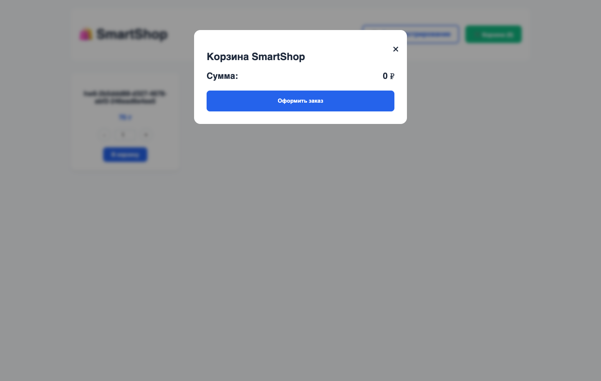

# Домашняя работа №6 — Selenium + Selenide

Условие: https://online.stepup.study/viewer/sessions/8167/tasks/4524

Решение подготовлено по трём предоставленным презентациям: лекция темы 6.1
«Selenium», лекция темы 6.2 «Selenide», вебинар темы 6. Учебное приложение —
`oa_at_train_project-1.0-SNAPSHOT.jar` из материалов курса.

## Организация

- `SeleniumHomeworkTest` содержит четыре теста на чистом Selenium, JUnit-ассерты
  и явные ожидания `WebDriverWait`. Браузер создаётся в `@BeforeEach`,
  закрывается через `quit()` в `@AfterEach`.
- `SelenideHomeworkTest` содержит пять тестов, `WebinarHomeworkTest` — четыре.
  В этих классах и `BaseSelenideTest` нет импортов или прямых вызовов Selenium.
  Все UI-проверки выполняются через `shouldBe` с условиями Selenide.
- Настройки и жизненный цикл Selenide вынесены в `BaseSelenideTest`.
  Каждый тест получает новый Chrome, поэтому корзина и авторизация изолированы.
- Page Object не используется, как указано в презентациях: браузерные действия
  находятся непосредственно в тестах. `UiTestData` занимается только API.
- `UiTestData.create()` генерирует товары через REST Assured. Уникальные имена
  и ID регистрируются для очистки. После каждого теста, в том числе упавшего,
  `@AfterEach` удаляет только созданные им товары. UI-товары находятся по
  уникальному имени; товары после редактирования удаляются по сохранённому ID.
- Сетевые ошибки подготовки/очистки считаются ошибкой инфраструктуры и не
  скрываются. API не заменяет проверяемые UI-действия: добавление, изменение,
  работа корзины и оформление заказа выполняются через браузер.
- `uiTest` запускает тег `ui` последовательно. Обычные задачи предыдущих работ
  сохраняют свои фильтры. Selenium доступен как зависимость Selenide 7.18.2.
  Для этой версии требуется Java 17, поэтому совместимость проекта обновлена.

## Покрытие критериев

| Пункт | Класс | Метод / реализация |
| --- | --- | --- |
| 1.1 | SeleniumHomeworkTest | adminCreatedProductAppearsInStorefront |
| 1.2 | SeleniumHomeworkTest | addedProductAppearsInCart |
| 1.3 | SeleniumHomeworkTest | invalidCredentialsAreRejected |
| 1.4 | SeleniumHomeworkTest | cartSurvivesPageRefresh |
| 1.5 | SeleniumHomeworkTest | startBrowser / closeBrowserAndDeleteData |
| 2.1 | SelenideHomeworkTest | adminCreatedProductAppearsInStorefront |
| 2.2 | SelenideHomeworkTest | addedProductAppearsInCart |
| 2.3 | SelenideHomeworkTest | invalidCredentialsAreRejected |
| 2.4 | SelenideHomeworkTest | cartSurvivesPageRefresh |
| 2.5 | SelenideHomeworkTest | orderAboveLimitShowsJavaScriptAlert |
| 2.6 | SelenideHomeworkTest | Все проверки — shouldBe с Conditions |
| 3.1 | WebinarHomeworkTest | threeUnitsAreAcceptedForProcessing: 3 × 100 = 300 ₽ |
| 3.2 | WebinarHomeworkTest | differentProductsHaveCorrectTotal: 2 × 35 + 60 + 90 = 220 ₽ |
| 3.3 | WebinarHomeworkTest | adminProductCreationShowsNotification |
| 3.4 | WebinarHomeworkTest | adminEditedProductIsPersisted |
| 3.5 | UiTestData / WebinarHomeworkTest | POST /goods/add для подготовки данных |
| 3.6 | BaseSelenideTest | @AfterEach → deleteCreatedGoods → DELETE /goods/{id} |

Корзина проверяется по уникальному товару, количеству и сумме. При редактировании
имя и цена проверяются после повторного открытия списка, а также на витрине:
проверка не ограничивается значением, которое тест только что ввёл в поле.

JS Alert — нативное окно браузера, у него нет DOM-элемента и стандартного
`shouldBe(visible)`. Поэтому тест вызывает Selenide `confirm()`: метод ждёт
настоящий alert и завершает тест ошибкой, если его нет. Захваченный текст
проверяется через `shouldBe(Condition.match(...))`, после чего проверяется,
что модальное окно корзины, товар и сумма остаются на месте. Прямые вызовы
`switchTo().alert()` и Selenium `Alert` не используются.
Описание API: https://selenide.org/javadoc/current/com/codeborne/selenide/Selenide.html

## Запуск

Нужны JDK 17+ и установленный Chrome. Selenium Manager автоматически находит
или скачивает ChromeDriver; для первого запуска нужен доступ к интернету.

Рекомендуется отдельный экземпляр с пустой базой: витрина учебного приложения
показывает только первые 20 товаров, админка — первые 100. Параллельное ручное
добавление товаров или запуск другого набора может повлиять на видимость данных.

Первый терминал:

```shell
SPRING_SERVER_PORT=8081 bash scripts/start-training-api.sh "$HOME/Downloads/oa_at_train_project-1.0-SNAPSHOT.jar.zip"
```

Используется локальная база H2 в памяти; перезапуск очищает её.
Если 8080 свободен, можно запустить без `SPRING_SERVER_PORT` и не задавать `UI_BASE_URL`.

Второй терминал:

```shell
read -s UI_PASSWORD
export UI_PASSWORD
export UI_BASE_URL=http://127.0.0.1:8081
./gradlew uiTest
```

Введите учебный пароль из вебинара после команды `read`. По умолчанию логин —
`admin`, браузер работает в headless-режиме. Пароль и архив не добавляются в Git.
При необходимости задайте `JAVA_HOME` на установленный JDK 17+.

Параметры:

| Назначение | Переменная | Системное свойство | По умолчанию |
| --- | --- | --- | --- |
| Адрес магазина и API подготовки | UI_BASE_URL | ui.baseUrl | http://127.0.0.1:8080 |
| Логин | UI_USERNAME | ui.username | admin |
| Пароль | UI_PASSWORD | ui.password | Обязательный; возможен fallback на API_PASSWORD |
| Headless | UI_HEADLESS | ui.headless | true |

Можно выполнить отдельный набор:

```shell
./gradlew uiTest --tests '*SeleniumHomeworkTest'
./gradlew uiTest --tests '*SelenideHomeworkTest'
./gradlew uiTest --tests '*WebinarHomeworkTest'
```

Для видимого браузера: `UI_HEADLESS=false ./gradlew uiTest`.

Отчёты:

- HTML: `build/reports/tests/uiTest/index.html`.
- JUnit XML: `build/test-results/uiTest/`.
- Скриншоты ошибок Selenide: `build/reports/tests/uiTest/screenshots/`.
- Регрессия предыдущего задания: `./gradlew test`.

## Фактический результат, 5 октября 2026

Проверено на JDK 17, Chrome и отдельном магазине `127.0.0.1:8081` с пустой базой.

| Набор | Всего | Успешно | Падений | Пропущено |
| --- | --- | --- | --- | --- |
| Selenium | 4 | 3 | 1 | 0 |
| Selenide | 5 | 4 | 1 | 0 |
| Вебинар | 4 | 4 | 0 | 0 |
| Регрессия задания №3 | 123 | 123 | 0 | 0 |

Два падения — один дефект приложения ниже. `uiTest` возвращает ненулевой код,
поскольку обязательные проверки сохранения корзины не проходят. Отключение
тестов, `ignoreFailures` и подмена ожидаемого результата не применяются.
После прогона отдельный GET `/goods/list` вернул `{"goods":[]}`:
тестовые товары удалены, включая данные двух упавших тестов.

## UI-BUG-01: корзина очищается после обновления страницы

**Предусловие:** открыт учебный магазин, добавлен товар стоимостью 70 ₽.

**Шаги:**

1. Указать количество 2 и нажать «В корзину».
2. Открыть корзину: товар отображается, счётчик — 2, сумма — 140 ₽.
3. Обновить страницу и снова открыть корзину.

**Ожидается:** товар, количество 2 и сумма 140 ₽ сохраняются, согласно пунктам
1.4 и 2.4 домашней работы.

**Фактически:** счётчик и сумма равны 0, товар отсутствует.

**Автотесты:** `SeleniumHomeworkTest.cartSurvivesPageRefresh` и
`SelenideHomeworkTest.cartSurvivesPageRefresh`.

**Причина в предоставленном приложении:** `index.js` создаёт `let cart = []`
при `DOMContentLoaded`; корзина не сохраняется и не восстанавливается.

Дефект воспроизведён двумя независимыми реализациями теста. После исправления
приложения тесты должны пройти без изменения ожиданий.

Скриншот из упавшего Selenide-теста после обновления:



## Сдача

Репозиторий: https://github.com/Anatoliy443/qa-autotest (публичный).
Для ответа в StepUp используйте ссылку на коммит с этим решением. В ответе
рекомендуется указать, что два теста обнаруживают дефект корзины, и приложить
ссылку на этот отчёт. Презентации курса и бинарный учебный сервер не публикуются.
